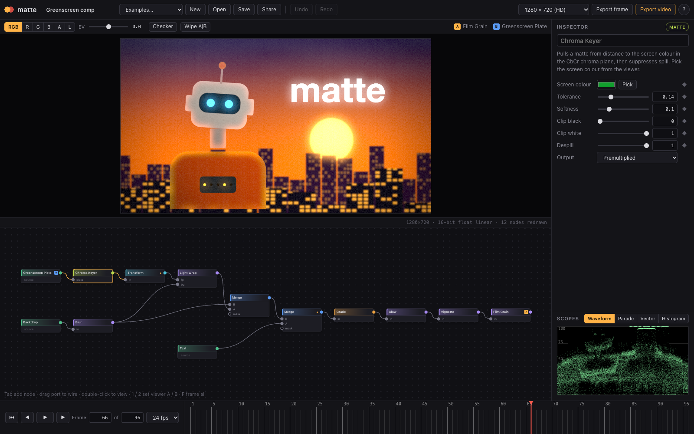
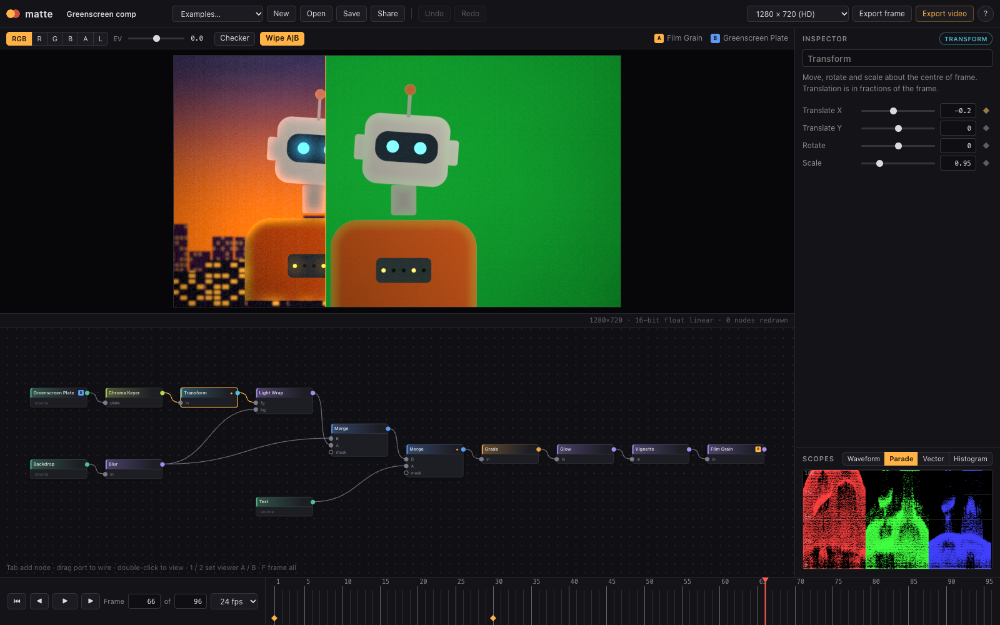
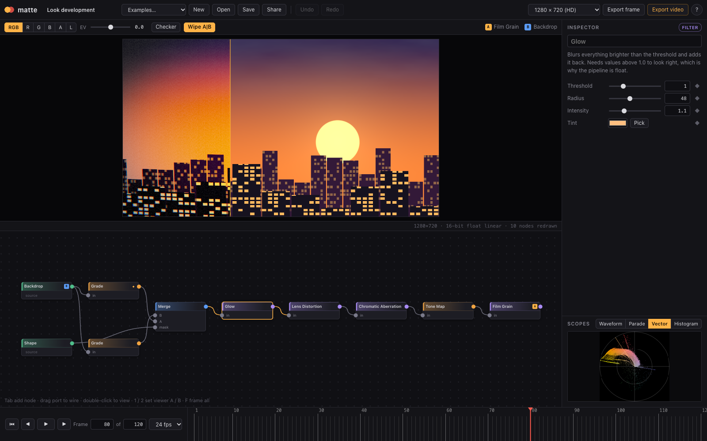

# matte

A node-based compositor that runs in the browser. Pull a chroma key, grade it, wrap the background
light around its edges, drop in a title, keyframe the move, check it on a waveform, and export the
shot, all on the GPU and without installing anything.

**[Open the live app](https://pmag11-alt.github.io/matte/)**



The picture above is entirely procedural. The "footage" is a shader that draws an animated subject
in front of an unevenly lit green screen with spill and sensor noise, so there is something to key
the moment the page loads. You can also drop your own image or video onto the window.

## What it does

| | |
|---|---|
| **Node graph** | 29 nodes in six groups, wired left to right. Tab opens a searchable add menu; dropping a wire on empty canvas creates the next node already connected. Cycles are rejected. |
| **Keying** | Chroma keyer working in the CbCr plane with tolerance/softness, matte clipping, spill suppression, and an eyedropper that samples the viewer. Matte choke/expand, garbage mattes from shapes, premult/unpremult. |
| **Integration** | Light wrap, merge with eight operations and an optional mask input, glow, film grain, lens distortion, chromatic aberration, vignette. |
| **Colour** | Exposure, white balance, lift, gain, contrast, gamma, saturation; ACES-fitted tone map. |
| **Editing** | Timeline with scrubbing and playback, keyframes on every numeric and colour parameter (linear, smooth, hold), dissolve/wipe/iris/dip transitions, text for titles. |
| **Viewer** | Channel solo (R, G, B, alpha, luma), exposure control, transparency checkerboard, A/B wipe between any two nodes, per-pixel readout. |
| **Scopes** | Waveform, RGB parade, vectorscope with skin-tone line, histogram. |
| **Project** | Undo/redo, autosave, JSON save/load, share links that carry the whole project in the URL, PNG and video export. |



## How it works

```
src/core    pure TypeScript, no DOM: data model, graph ops, keyframes, colour maths, scopes, node library
src/gl      WebGL2 evaluator
src/ui      editor panels, written against the DOM directly (no framework)
tests       137 unit tests over src/core
```

**Linear light, premultiplied alpha, float buffers.** Every wire carries linear RGBA with
premultiplied alpha in an `RGBA16F` texture. sRGB is decoded when an image enters the graph and
encoded once, in the viewer. That is what makes blurs, merges and glows behave the way they do in a
real compositing package: a defocused highlight stays bright instead of turning grey, and values
above 1.0 survive until the tone map. Colour operations unpremultiply first so edges do not fringe.

**Each node is a fragment shader plus a typed parameter list.** The whole library lives in
[`src/core/nodes.ts`](src/core/nodes.ts). A node declares its inputs and parameters and provides
`vec4 run(vec2 uv)`; uniforms are generated from the parameter list, so the inspector, the
serialiser, the keyframe system and the shader all read from one definition. Adding a node is about
twenty lines.

**Evaluation is pull-based and incremental.** Rendering starts at the viewed node and walks
upstream. Each node is fingerprinted (FNV-1a) from its type, its parameters at the current frame
and the fingerprints of its inputs, and it is redrawn only when the fingerprint changes. Dragging a
slider on the last node of a twelve-node chain redraws one node; the status line under the viewer
shows the count. Multi-pass nodes (blur, glow, light wrap) ping-pong between two scratch targets.

**The keyer** measures distance from the screen colour in the CbCr chroma plane rather than in
RGB, which keeps it tolerant of a screen that is brighter in the middle than at the edges. Spill
suppression clamps the screen's dominant channel to the average of the other two. The same maths
exists in TypeScript in [`src/core/color.ts`](src/core/color.ts), where it is unit-tested; one of
those tests is what set the node's default tolerance.

**State is plain JSON.** Undo is a stack of snapshots, a share link is the same JSON deflated into
the URL fragment, and files opened from disk go through a sanitiser that drops unknown node types,
malformed parameters, dangling wires and cycles instead of trusting them.



## Nodes

| Group | Nodes |
|---|---|
| Source | Greenscreen Plate, Backdrop, Read (image/video), Text, Constant, Ramp, Checkerboard, Noise, Shape |
| Color | Grade, Tone Map, Invert |
| Matte | Chroma Keyer, Matte Tools, Mask, Premult |
| Filter | Blur, Glow, Light Wrap, Sharpen, Edge Detect, Chromatic Aberration, Lens Distortion, Vignette, Film Grain, Glitch |
| Transform | Transform |
| Merge | Merge, Transition |

## Shortcuts

| Key | Action |
|---|---|
| `Tab` | Add a node |
| double-click, `1` | View node (A) |
| `2`, `W` | Set wipe side B, toggle wipe |
| `R` `G` `B` `A` `L` | Solo a channel |
| `Space`, `←` `→` | Play, step |
| `Delete`, `Ctrl/⌘ D` | Delete, duplicate |
| `Ctrl/⌘ Z`, `Shift Z` | Undo, redo |
| `F` | Frame the graph |

## Run it locally

```bash
npm install
npm run dev        # http://localhost:5173
npm test           # unit tests
npm run build      # typecheck + production bundle in dist/
```

Requires Node 20.19+ and a browser with WebGL2. There are no runtime dependencies; the production
bundle is about 30 kB gzipped.

## Testing

The core is deliberately free of DOM and GL so it can be tested in plain Node:

- graph editing: single wire per input, fan-out, cycle rejection, topological order, duplication
- keyframes: interpolation modes, vector values, immutability of edits
- colour: sRGB round trip, chroma-plane properties, keyer and despill behaviour
- scopes: histogram bins, waveform and vectorscope plotting
- loading: a hostile project file is reduced to its valid subset
- shader library: every node's GLSL is statically checked for undeclared or unused uniforms,
  inputs it does not declare, and integer literals where GLSL ES needs floats

The GLSL itself is compiled by the browser at startup (`Renderer.compileAll`), and a node whose
shader fails is outlined in red with the compiler log in the inspector.

## Limits

- Video export records the canvas in real time with `MediaRecorder`, so it is display-referred
  8-bit WebM and a slow machine can drop frames. Frame-accurate export through WebCodecs is the
  obvious next step.
- Imported media is not stored in the project or in share links; reopen the file after loading.
- One resolution per project; there is no per-node format or region of interest.
- Blur taps spread out with radius, so very large radii are approximate.
- Keyframes are edited at the playhead; there is no curve editor.

## License

MIT
